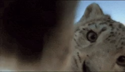
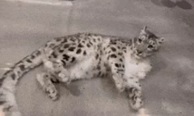

# Panthera Uncia

*just a quiet spot on the peaks for art, notes, and random ideas.*

---

### about me

hey there. i spend most of my time drawing, tinkering with characters, and collecting bits of visual inspiration. i tend to keep things pretty chill and low-key, mostly drawn to quiet, wintry aesthetics and every kind of leopard out there—especially snow leopards. this page is just a personal corner to keep my creative stuff organized away from the noise.

---

### what's inside

* **finished stuff** — polished pieces and completed work ready to look at
* **drafts & sketches** — messy notes, early ideas, and works in progress
* **moodboards** — saved references, visual inspiration, and stray thoughts
* **updates** — a loose log of what i've been adding or changing lately

---

### current focus

> *"moving quietly through snow and granite."*

* **main project** — drop a quick note here about the main thing you're creating right now
* **side project** — something smaller you're tinkering with on the side
* **later down the road** — an idea sitting on the back burner for another day

---

### little things i like

* **atmosphere** — crisp mountain air, overcast skies, and quiet late nights
* **details** — clean character silhouettes, soft monochrome palettes, and subtle textures
* **pace** — taking time with ideas and letting projects grow without rushing them

---

more updates coming soon • just come back for more updates
