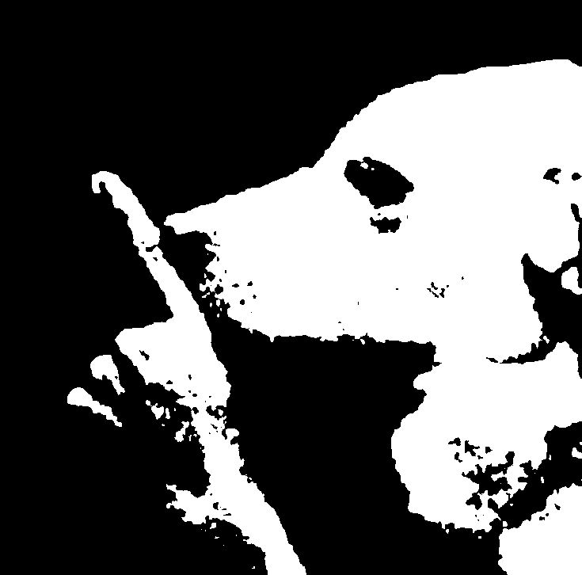

<div align="center">

### <code><span style="color: #808080;">hello</span></code>
<sub>Character Lore • Personal Web Spaces</sub>

<br>

<kbd>CHARACTER DESIGN</kbd> &nbsp; <kbd>IBISPAINT</kbd> &nbsp; <kbd>MONOCHROME</kbd> &nbsp; <kbd>GMT+7</kbd>

</div>

---

### `01 // OVERVIEW`

```text
> Welcome. Feel free to look around this personal archive.
> Focused on original character design, digital art, and indie web layouts.
> Inspired by snow leopards, black-and-white contrast, and quiet spaces.
```

> *Thoughtful, creative, and chill — building small visual worlds and organizing original concepts piece by piece.*

---

### `02 // ARCHIVE INDEX`

| Code | Domain | Description | Status |
| :--- | :--- | :--- | :--- |
| **`ARC-01`** | **Character Lore** | Original designs, distinct personalities, and interconnected stories | `DEVELOPING` |
| **`ARC-02`** | **Visual Studies** | High-contrast black-and-white artwork, lighting, and atmosphere | `ACTIVE` |
| **`ARC-03`** | **Web Spaces** | Minimal single-page layouts, directories, and indie web experiments | `CURATING` |
| **`ARC-04`** | **Concept Vault** | Rough sketches, visual motifs, and unfinished worldbuilding notes | `ARCHIVING` |

---

### `03 // FIELD NOTES`

<details>
<summary><b><code>[+] Note 01 — Creative Direction & Aesthetics</code></b></summary>
<br>

* **Visuals:** Pure black-and-white contrast, soft greyscale shadows, and quiet editorial layouts.
* **Motifs:** Snow leopards, subtle architectural lines, and atmospheric storytelling.
* **Approach:** Keeping spaces uncluttered so individual character details stand out.

</details>

<details>
<summary><b><code>[+] Note 02 — Tools & Palette</code></b></summary>
<br>

```text
ILLUSTRATION   ::  ibisPaint
WEB STRUCTURE  ::  Minimal HTML / CSS / Markdown
PALETTE        ::  #000000 (Black) • #808080 (Grey) • #FFFFFF (White)
TIMEZONE       ::  GMT+7
```

</details>

<details>
<summary><b><code>[+] Note 03 — Current Focus</code></b></summary>
<br>

* Refining original character silhouettes and expression sheets.
* Experimenting with black-and-white web directories and guestbook layouts.
* Organizing visual lore into clean, readable records.

</details>

---

<table>
  <tr>
    <td width="140" align="center">
      
    </td>
    <td>
      <blockimg>
        <em>"great."</em>
      </blockquote>
      <sub>— your dog</sub>
    </td>
  </tr>
</table>

<br>

<details>
<summary><b><code> About Me — Personal Summary</code></b></summary>
<br>

```text
DISPOSITION  ::  Thoughtful • Creative • Chill
TIMEZONE     ::  GMT+7
PASTIMES     ::  Sketching in ibisPaint, building quiet web layouts, worldbuilding
MOTIFS       ::  black-and-white contrast, late-night solitude
```

> Moving at an unhurried pace—spending quiet hours designing original characters, experimenting with minimal monochrome pages, and collecting pieces of atmospheric stories along the way.

</details>

<br>

**`[ do not click ]`**

<a href="https://youtu.be/dQw4w9WgXcQ?si=tyYcYDDr03I74tML">
  
</a>


